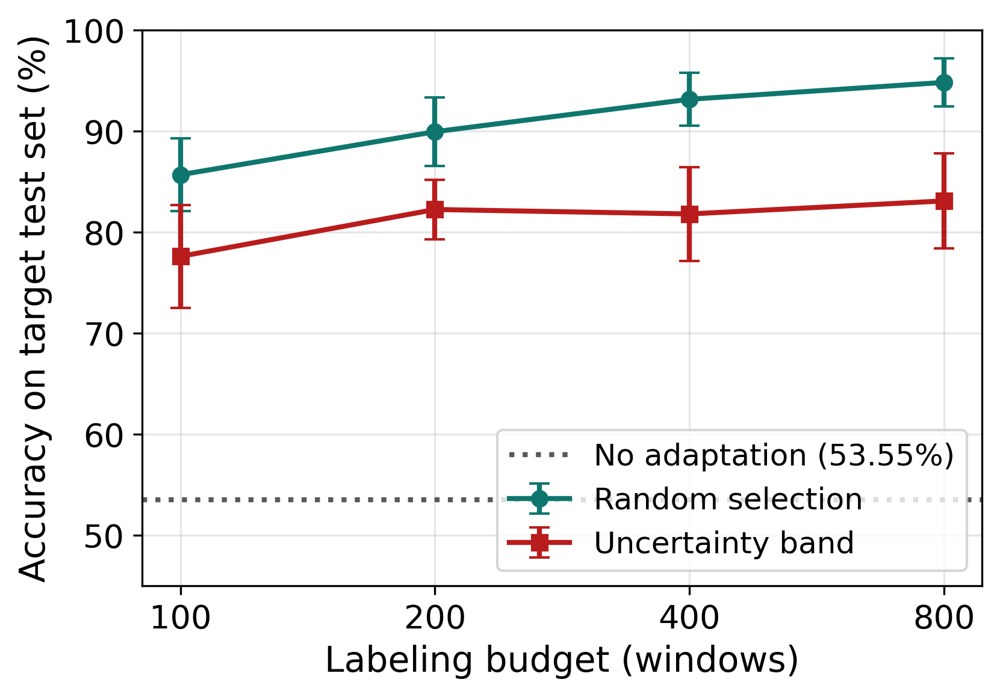
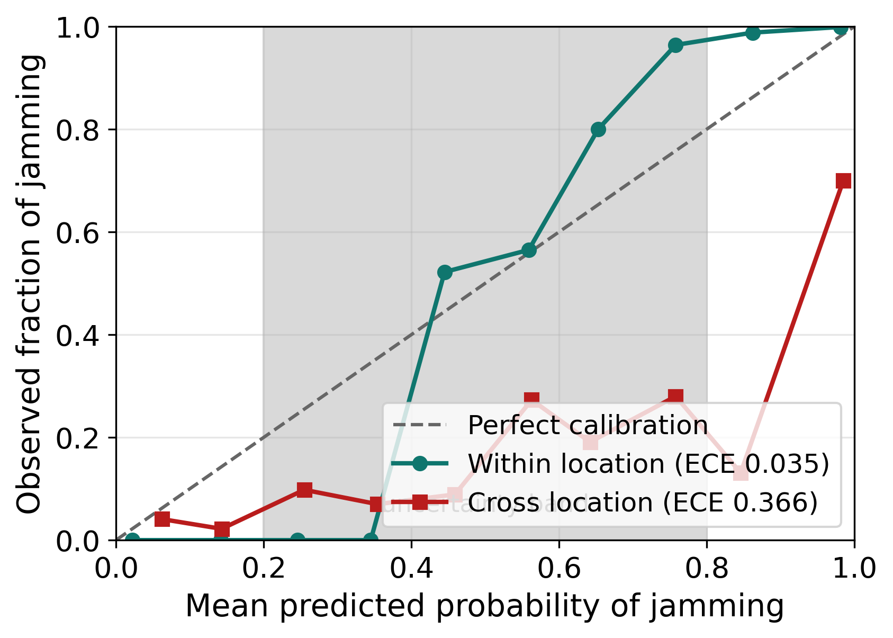
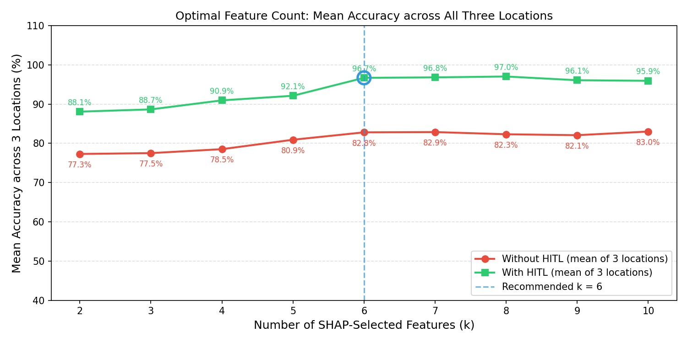

# Human-in-the-loop explainable AI for RF jamming detection

Detecting jamming attacks on a wireless physical layer, explaining the
detector, and adapting it to a site it has never seen using a small number of
expert labels.

Master's thesis, 2026, graded A+. The revised experiments here are the ones
behind *Human-in-the-Loop Explainable AI for Detection and Mitigation of
Physical Layer Wireless Attacks*, Y. El Sebaei, M. Shammaa, M. Ashour, accepted
at IC-FTAI 2026 (IEEE).

A Random Forest over 49 spectral features separates jamming from benign traffic
almost perfectly inside the location it was trained on, and falls apart the
moment it is moved:

| | Location 1 | Location 2 | Location 3 |
|---|---|---|---|
| Within location, 49 features | 99.21% | 99.96% | 100.00% |
| Trained on the other two locations, no adaptation | 51.05% | 98.04% | 91.07% |
| After 800 expert labels | **94.83%** | **99.62%** | **98.13%** |

Location 1 is the interesting one. Everything below is about why a detector
that looks finished collapses to a coin flip at a new site, and what actually
fixes it.

---

## Three results worth the reading

**The standard active learning heuristic makes it worse, not better.** Showing
the expert the samples the model is least sure about is the textbook move. At
Location 1 it loses to random sampling at every budget and in every seed:

| Labelling budget | Uncertainty band | Random | Difference |
|---|---|---|---|
| 100 | 77.61% ± 5.09 | 85.69% ± 3.58 | **-8.07 pp** |
| 200 | 82.25% ± 2.96 | 89.95% ± 3.39 | **-7.71 pp** |
| 400 | 81.81% ± 4.63 | 93.16% ± 2.60 | **-11.35 pp** |
| 800 | 83.10% ± 4.70 | 94.83% ± 2.38 | **-11.73 pp** |

Zero wins out of five seeds at every budget.



**Because the probabilities the band is built from are not trustworthy across
locations.** The within-location model is close to calibrated, ECE 0.035. The
cross-location model is not, ECE 0.366, and inside the 0.2 to 0.8 band it
predicts a mean of 0.635 while the observed jamming rate is 0.222.



The consequence is concrete: the uncertainty band is 76.1% benign while random
sampling is 48.7% benign, so the expert spends their budget confirming benign
windows. The failure is not that uncertainty sampling is a bad idea, it is that
it inherits the calibration of the model choosing the samples, and that
assumption breaks under distribution shift. A reliability check before trusting
a selection rule is cheap, and this is what it buys.

**Most of the gap closes with no labels at all.** Before paying for any expert
time, standardising the features per location recovers two thirds of what 800
labels buy:

| Adaptation at Location 1 | Accuracy |
|---|---|
| None | 53.55% ± 2.52 |
| Per-location standardisation, no labels | 84.07% ± 4.71 |
| Self-training on confident pseudo-labels, no labels | 57.13% ± 3.00 |
| 800 random expert labels | 94.83% ± 2.38 |

Self-training barely helps, and the reason is in the numbers: 5,817
pseudo-labels added, only 62.4% of them correct. A model that is wrong about a
new site is also confidently wrong about it.

## Explainability, and cutting 49 features to 9

SHAP over the training data ranks the features, and the top 9 carry almost
everything:

| | Accuracy | Train time | Inference | Model size |
|---|---|---|---|---|
| 49 features | 99.21% | 7.08 s | 17.4 us/window | 738 KiB |
| 9 features | 98.80% | 4.47 s | 18.5 us/window | 837 KiB |

An 82% cut in inputs for 0.4 points of accuracy. Worth being precise about what
that buys: feature extraction gets much cheaper and training is a third faster,
but inference is not faster and the model is not smaller. The trees simply grow
deeper when given fewer columns, 9,942 nodes against 8,668. The win is in the
feature pipeline, not the classifier.

The nine selected within location are dominated by gain and power statistics:
`total_gain_db_mean`, `total_gain_db_q25`, `avgpwr_db_max`, `rssi_std`,
`max_magnitude_max`, `max_magnitude_std`, `total_gain_db_q50`,
`base_pwr_db_q75`, `total_gain_db_min`. Seven of them come from the same
`total_gain_db` family and correlate at 0.721 mean absolute off-diagonal, so
the set is redundant by construction. SHAP ranks features by contribution, not
by independence.

With the human in the loop, accuracy against k saturates around k = 8:



## How much of this survives scrutiny

**Five seeds, not one.** Every headline number is mean ± standard deviation
across five random seeds. `results/multi_seed_rigour.txt` has the spread.

**Window level splits are not inflating the within-location numbers.** A
random 70/30 split and a contiguous, order-preserving one differ by at most
0.12 pp across all three locations, so temporally adjacent windows landing on
both sides of the split is not where the 99% comes from.

**Expert accuracy matters, and the curve is not linear.** Dropping the
simulated reviewer from perfect to 80% correct costs about 1.5 points. Dropping
to 50%, which is random labelling, takes it back to 54.6%, below where it
started.

## Layout

```
pipeline/      raw capture to windowed feature table
experiments/   numbered in the order the story runs, 01 to 17
data/          the per-location feature sets the experiments read
results/       console output from the runs the README quotes
figures/       every figure, regenerated by experiments/16
```

The raw captures are not in this repository. They are tens of megabytes of
spectrum recordings from the public dataset the thesis builds on, and the
feature tables derived from them are what every experiment actually reads.
`pipeline/extract_features.py` is the code that turns one into the other,
128-sample windows with no overlap.

## Running it

```
pip install -r requirements.txt
python experiments/01_within_location_baseline.py
python experiments/14_reviewer_revision_part1.py
```

Everything runs from the repository root on CPU. The revision drivers take a
few minutes because they repeat across seeds, budgets and locations; the
baseline is seconds.

## Stack

Python, scikit-learn, SHAP, pandas, NumPy, Matplotlib. Pinned in
`requirements.txt`.
